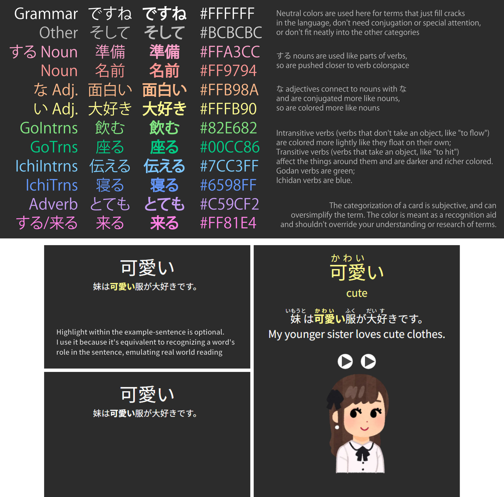

# ColorKaishi
Anki addon to color-code Kaishi 1.5k v2 deck

https://ankiweb.net/shared/info/1768036950

An addon to color-code kaishi 1.5k, 
so you can automatically differentiate these categories without any guessing or searches.

Cards work on mobile, too, because the plugin just writes a color-code into the card, which is read in the card's html and css to render the color.

(the color is stored in the card's "frequency" field, which normally isn't used to display anything)

 

Installation:

- Install the add-on as normal

- Browse cards, select "Cards..." and select Kaishi's card type.

    - In the Back Template tab,

        - Before `{{Furigana:Word furigana}}`,
           add `
`

        - After `{{Word Meaning}}
`,
           add `
`

        (You can do this on the Front Template, too, if you'd like; just place the `div` and `/div` before and after `{{Word}}`)

    - To color the example sentences:

        - In the Styling tab, at the bottom,
           replace `b{color: #5586cd}`
           with `b{color: var(--freq-color, #ffffff);}`

           (To make the example-text all-white, you can just swap out 5586cd for ffffff and ignore the next two steps.)

        - In the Back Template tab, around where you see Sentence furigana,
           replace `
`
           with `
`

        - Optionally, in the Front Template tab,
           replace `
`
           with `
`
    
    - Hit Save

- Open the Tools menu and select Color Kaishi

 

We categorized every card in Kaishi 1.5k using the following process:

- Python script (see github) scrapes jisho.org/word/{word} for exact matches of terms, uses first result from jisho.org/search/{word} otherwise:

  - This gives the term's "meaning tags"  

- "Meaning tags" were processed using a basic algorithm to find the most common use of a term ([spreadsheet](https://docs.google.com/spreadsheets/d/1BZiNtmv8dbPIVCvC65-xJMYgPLLm6aqMlonox1L64jI/view))

  - Search the Meaning Tags left-to-right for keywords like "noun", "verb", etc

  - If more specificity is needed (e.g. type of verb), use another left-to-right pass for keywords like "intransitive"

- Manually corrected obvious mismatches.

  - Searched for more mismatches by giving an LLM the anki deck and our list. Manually corrected everything it flagged.

